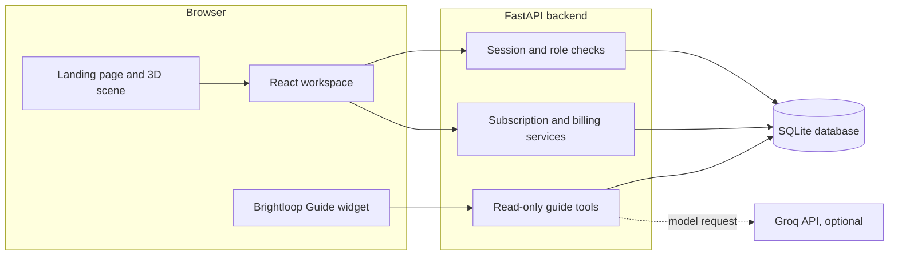

<div align="center">


<p>
  
  
  <a href="#local-demo"></a>
</p>

<p>
  
  
  
  
  
</p>

<br />

> ### From the first quote to every renewal, keep the whole revenue story in view.
> Brightloop OS brings subscription lifecycle, recurring billing, payment reconciliation, finance insight, and role-aware guidance into one workspace.

<br />


</div>

---

## Table of Contents

- [The Problem](#the-problem)
- [What We Built](#what-we-built)
- [Feature Tour](#feature-tour)
- [Business Guardrails](#business-guardrails)
- [Demo Video](#demo-video)
- [Architecture](#architecture)
- [Technology](#technology)
- [Data Model](#data-model)
- [Roles and Access](#roles-and-access)
- [Local Demo](#local-demo)
- [Project Structure](#project-structure)
- [Team Synora](#team-synora)

---

## The Problem

Recurring revenue is managed across disconnected moments: a quote is prepared, a plan is selected, a subscription changes state, an invoice is generated, a payment arrives, and someone has to explain what happened. When each step lives in a different tool or spreadsheet, it becomes difficult to see the full customer and finance picture.

**Brightloop OS connects those moments.** It gives operations, finance, and customers a shared subscription workflow with clear rules, traceable events, and a time-aware view of what is due next.

## What We Built

Brightloop is a subscription operations and revenue intelligence workspace designed for the Odoo Make-A-Ton challenge.

```text
Catalog and quote  ->  Subscription lifecycle  ->  Billing and payment  ->  Finance insight
 Products, plans,      Accept, activate, pause,     Invoices, partial       MRR, ARR, margin,
 taxes, discounts      renew, close, add-ons        payments, matching      collections, aging
```

- A light, editorial landing page with a procedural Three.js revenue engine that floats in the open layout and responds to scroll.
- Six product chapters with glass feature cards that transition as the story advances.
- A role-aware workspace for administrators, operations staff, finance leads, and customers.
- A server-backed subscription and billing flow with reusable quotation templates and plan rules.
- Explainable bank statement matching with human confirmation before a payment is posted.
- A persisted business clock, local message outbox, and audit trail for a coherent demo journey.
- Brightloop Guide, an optional read-only assistant for product questions and role-scoped workspace lookups.

## Feature Tour

### One connected subscription lifecycle

Create a quote from a reusable template, review its lines and margin preview, and follow it through quotation, confirmation, activation, pause, renewal, or close. Plan settings define which lifecycle changes are available.

### Billing with a memory

Generate recurring invoices by subscription period, calculate tax and eligible discounts, confirm or cancel invoices, print them, and record partial or final payments. Billing generation is idempotent for each subscription and period.

### Explainable payment reconciliation

Import a bank CSV or OFX statement. Brightloop scores potential invoice matches using reference, amount, payer, and date signals, then shows a reason for the suggestion. A staff member confirms a row before it changes a balance.

### Finance in context

Review MRR and ARR, collections, outstanding balances, overdue exposure, aging buckets, and margin. Finance views connect the portfolio summary to recent invoices and payments.

### A clock for the whole demo

Advance the persisted business date by day, week, month, or a custom date. The clock processes due billing, quotation expiry, renewal notices, and staged overdue reminders. Generated email-like messages stay in the local outbox.

### Brightloop Guide

When a Groq API key is configured, Brightloop Guide can answer product questions and look up records permitted for the signed-in role. It is read-only and returns source references. The default model is `openai/gpt-oss-120b`.

### A scroll-driven landing page

The landing page keeps one procedural revenue engine in view while visitors move through six chapters. Its faceted core, three tilted orbit rings, and six feature nodes respond to scroll progress. The active chapter selects a matching glass feature card. Reduced-motion and WebGL fallback behavior uses the bundled static orb artwork.

## Business Guardrails

| Area | Product rule |
|------|--------------|
| Account access | Customer records are scoped to the signed-in customer. Staff and admin operations are checked by the API. |
| Plan lifecycle | Pause, early close, renewal, and automatic closure respect the selected plan settings. |
| Quotations | Template pricing, eligible discounts, tax, and estimated margin are previewed before creation. A 15% margin threshold raises a warning. |
| Recurring invoices | A subscription has at most one generated invoice for a billing period. |
| Payments | Payment amounts update invoice balances. Cancellation is blocked after a payment has been recorded. |
| Reconciliation | A match is a suggestion. A person must confirm before Brightloop records the payment. |
| Add-on changes | Mid-cycle price changes use a day-weighted proration and carry the adjustment into the next invoice. |
| Audit and messages | Important workflow events are added to the audit trail and generated messages appear in the local outbox. |

## Demo Video

The ready-to-record narration and shot list is prepared separately for the submission. It is paced for about four minutes and uses the seeded local demo workspace.

## Architecture



- **Frontend:** React and TypeScript served by Vite. The Three.js scene loads separately from the main app bundle.
- **Backend:** FastAPI routes call SQLAlchemy services for business rules, reporting, authentication, and workflow transitions.
- **Local data:** SQLite uses WAL mode and foreign keys. Alembic migrations are applied by the startup script.
- **Guide:** Groq access is optional. Workspace lookup tools are read-only and apply the current user's role scope.
- **Outbox:** The demo records notification content locally instead of delivering external email.

## Technology

| Layer | Technology |
|-------|------------|
| Interface | React 19, TypeScript, Vite |
| Landing scene | Three.js, procedural geometry, CSS scroll chapter observation |
| Icons | Lucide React |
| API | Python, FastAPI, Pydantic |
| Persistence | SQLAlchemy, SQLite WAL, Alembic |
| Password storage | Scrypt password hashing and server-issued sessions |
| Optional assistant | Groq Chat Completions API, `openai/gpt-oss-120b` |

## Data Model

The backend persists users and sessions, products and variants, tax rules, plans, discounts, quotation templates, subscriptions and lines, invoices and lines, payments, reconciliation batches and rows, outbox messages, audit events, and system settings such as the business clock.

Money is stored as integer cents. Billing periods, invoice balances, discount eligibility, proration, finance totals, and access checks are handled by the backend.

## Roles and Access

| Persona | Role | Example scope |
|---------|------|---------------|
| Admin | `ADMIN` | Catalog and plan setup, staff accounts, operations, finance, and scale demo controls |
| Operations staff | `STAFF` | Subscription operations, billing, time controls, payment entry, and reconciliation |
| Finance lead | `STAFF` | Finance overview, reporting, and revenue review |
| Customer | `CUSTOMER` | Own subscriptions, quotations, invoices, payments, and messages |

The Finance Lead demo is a staff account with a finance-focused view. The API remains the source of truth for permissions.

## Local Demo

### Requirements

- Windows PowerShell
- Node.js 20.19 or newer
- Python 3.11 or newer

### Start Brightloop

From the repository root:

```powershell
.\start.ps1
```

The script creates a backend virtual environment, installs Python and frontend dependencies when needed, applies database migrations, and starts the API and Vite server.

- Web app: [http://127.0.0.1:5173](http://127.0.0.1:5173)
- API health: [http://127.0.0.1:8000/api/health](http://127.0.0.1:8000/api/health)
- Interactive API docs: [http://127.0.0.1:8000/docs](http://127.0.0.1:8000/docs)
- Stop both local processes with `stop.ps1` from the repository root.

The database is created at `data/brightloop.db` and seeded on first startup. The demo persona selector is enabled by `start.ps1`.

### Seeded demo accounts

The sign-in screen provides one-click demo personas. The seeded local accounts are also available for email sign-in:

| Persona | Email |
|---------|-------|
| Admin | `admin@brightloop.local` |
| Operations staff | `staff@brightloop.local` |
| Finance lead | `finance@brightloop.local` |
| Customer | `customer@brightloop.local` |

Seeded password: `Brightloop!2026`. This password and demo persona login are for a local judging environment only. Do not expose the demo server publicly.

### Optional Brightloop Guide setup

Set a Groq key in the shell before running `start.ps1` if the demo will include Brightloop Guide:

```powershell
$env:GROQ_API_KEY = "your Groq API key"
$env:GROQ_MODEL = "openai/gpt-oss-120b"
.\start.ps1
```

Never place an API key in this README or commit it to the repository. Without a key, the rest of the product works and the Guide reports that it is not configured.

## Project Structure

```text
.
├── backend/
│   ├── app/
│   │   ├── main.py                 # API routes and workflow orchestration
│   │   ├── services.py             # seeding, billing, clock, and shared services
│   │   ├── assistant_agent.py      # optional role-scoped Brightloop Guide
│   │   ├── models.py               # SQLAlchemy data model
│   │   ├── schemas.py              # request and response validation
│   │   ├── security.py             # passwords, sessions, and role checks
│   │   └── database.py             # SQLite configuration
│   └── migrations/                 # Alembic schema history
├── frontend/
│   ├── src/
│   │   ├── LandingPage.tsx         # product story and chapter transitions
│   │   ├── RevenueEngineScene.tsx  # scroll-linked Three.js sculpture
│   │   ├── AssistantWidget.tsx     # workspace guide panel
│   │   └── App.tsx                 # sign-in and operations workspace
│   └── package.json
├── data/                           # local database created at runtime
├── start.ps1
└── stop.ps1
```

## Team Synora

Built for the **Odoo Make-A-Ton 2026** by **Team Synora**.

> Brightloop's thesis: make every subscription decision, billing event, and revenue signal part of one understandable customer journey.

<div align="center">

<br />

**[Run the local demo](#local-demo)**


</div>
