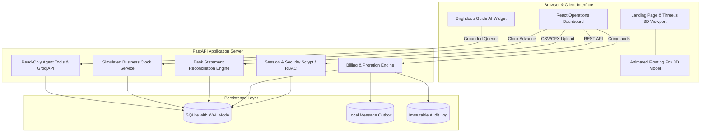

<div align="center">


<br />

[-714B67?style=for-the-badge&logo=odoo&logoColor=white)](https://github.com/atharva-awade/Team-Synora-Odoo-Make-A-Ton-9.0.git)
[](https://github.com/atharva-awade/Team-Synora-Odoo-Make-A-Ton-9.0.git)
[](#-quickstart--local-demo)
[](LICENSE)

<br />

<p align="center">
  
  
  
  
  
  
</p>

<br />

> ### *From the first quotation to every recurring renewal, keep the entire revenue story in one clear flow.*
> **Brightloop OS** unites subscription lifecycle orchestration, automated recurring billing, AI-assisted bank reconciliation, finance analytics, and role-scoped intelligence into an elegant, production-grade workspace.

<br />


</div>

---

## 📑 Table of Contents

- [✨ Key Highlights](#-key-highlights)
- [🎯 The Problem and The Brightloop Solution](#-the-problem-and-the-brightloop-solution)
- [🦊 Interactive 3D Experience (Three.js WebGL)](#-interactive-3d-experience-threejs-webgl)
- [🚀 Core Capabilities](#-core-capabilities)
  - [1. Subscription Lifecycle Orchestration](#1-subscription-lifecycle-orchestration)
  - [2. Automated Recurring Billing \& Proration](#2-automated-recurring-billing--proration)
  - [3. Explainable Bank Reconciliation](#3-explainable-bank-reconciliation)
  - [4. Real-time Finance \& Aging Analytics](#4-real-time-finance--aging-analytics)
  - [5. Time Travel Business Clock](#5-time-travel-business-clock)
  - [6. Brightloop Guide (Role-Scoped AI)](#6-brightloop-guide-role-scoped-ai)
- [🛡️ Business Guardrails \& Anti-Churn Rules](#️-business-guardrails--anti-churn-rules)
- [🏗️ System Architecture](#️-system-architecture)
- [👥 Personas \& Pre-seeded Accounts](#-personas--pre-seeded-accounts)
- [⚡ Quickstart & Local Demo](#-quickstart--local-demo)
- [📁 Project Layout](#-project-layout)
- [🏆 Team Synora](#-team-synora)

---

## ✨ Key Highlights

- **Unified Revenue Pipeline:** Seamless handoffs from Catalog & Templates $\rightarrow$ Quotation $\rightarrow$ Subscription Activation $\rightarrow$ Invoicing $\rightarrow$ Payment $\rightarrow$ Reconciliation $\rightarrow$ Ledger.
- **Interactive 3D Mascot Scene:** An animated **Floating Fox** 3D model with orbital rings and dynamic chapter nodes that reacts seamlessly to viewport scroll.
- **Explainable Bank Statement Matcher:** Parses OFX / CSV statements and provides multi-factor confidence scoring with transparent explanations before posting.
- **Time-Travel Business Engine:** Built-in business clock simulator that allows judges to advance time by days, weeks, or months to watch dunning notices, recurring billing cycles, and subscription renewals trigger deterministically.
- **Enterprise Margin Defense:** Real-time quotation margin calculation with guardrail alerts preventing discounts from selling contracts below product floor cost.
- **Role-Aware Security Boundaries:** Strict RBAC separating Administrator, Operations Staff, Finance Lead, and Customer views and data queries.

---

## 🎯 The Problem and The Brightloop Solution

Recurring revenue models fail when operations fragment across disconnected tools:
- Sales creates custom discounts without checking unit economics or cost floors.
- Operations struggles to manage prorated add-ons, pauses, and renewals mid-cycle.
- Invoicing and payment confirmation require manual spreadsheet reconciliations.
- Customers lack real-time visibility into their recurring balance and open invoices.

**Brightloop OS bridges every gap.** It establishes a coherent single source of truth where business logic, database transactions, and human-in-the-loop approvals collaborate smoothly.

```
┌────────────────────┐     ┌──────────────────────┐     ┌─────────────────────┐     ┌────────────────────┐
│ Catalog & Quoting  │ ──► │ Lifecycle Automation │ ──► │ Billing & Matching  │ ──► │ Finance Intel      │
│ Tiered plans, tax, │     │ Trial, activate,     │     │ Automated invoices, │     │ MRR, ARR, Aging,   │
│ margin guardrails  │     │ pause, renew, close  │     │ CSV/OFX statement   │     │ Margin analysis    │
└────────────────────┘     └──────────────────────┘     └─────────────────────┘     └────────────────────┘
```

---

## 🦊 Interactive 3D Experience (Three.js WebGL)

The landing page features a custom **Three.js WebGL viewport** hosting an animated **Floating Fox** mascot orbiting with procedural rings and chapter light nodes:
- **GLTF / GLB 3D Pipeline:** Loads the animated floating model via `three/examples/jsm/loaders/GLTFLoader` with skeletal keyframe animations.
- **Scroll-Linked Kinematics:** As visitors scroll through the six product chapters, the model rotates along dynamic spline curves, orbital rings spin, and corresponding chapter markers illuminate.
- **Graceful Degradation:** Full support for reduced-motion preferences (`prefers-reduced-motion`) and automatic fallback to lightweight vector artwork if WebGL is unavailable.

---

## 🚀 Core Capabilities

### 1. Subscription Lifecycle Orchestration
- Configurable subscription plans (Monthly, Quarterly, Annual) with custom trial periods and grace periods.
- Full state machine: `QUOTATION` $\rightarrow$ `CONFIRMED` $\rightarrow$ `ACTIVE` $\rightarrow$ `PAUSED` $\rightarrow$ `RENEWED` $\rightarrow$ `CLOSED`.
- Day-weighted proration calculation for mid-period upgrades, downgrades, or add-on modifications.

### 2. Automated Recurring Billing & Proration
- Strict idempotent billing generation ensuring zero duplicate invoices per period.
- Comprehensive tax calculation, launch promotional codes, and basis-point percentage discounts.
- Native currency handling formatted in Indian Rupees (₹ / paise integer arithmetic).

### 3. Explainable Bank Reconciliation
- Ingests standard bank exports (CSV & OFX).
- Multi-vector heuristic matching engine evaluating:
  - Exact reference numbers
  - Amount matches & partial residual offsets
  - Payer name entity correlation
  - Timestamp proximity
- Explains the exact reason for every proposed match and requires human staff verification before posting.

### 4. Real-time Finance & Aging Analytics
- Real-time **Monthly Recurring Revenue (MRR)** and **Annual Run Rate (ARR)** calculation.
- Accounts Receivable (AR) aging analysis segmented into 0–30, 31–60, 61–90, and 90+ day risk buckets.
- Customer-by-customer margin breakdown and payment collection timelines.

### 5. Time Travel Business Clock
- Accelerate the passage of time to demonstrate recurring operations without waiting weeks:
  - Trigger upcoming automated renewals
  - Generate next month's billing batch
  - Execute multi-stage automated dunning notifications (Friendly $\rightarrow$ Urgent $\rightarrow$ Service Review)
- Complete internal outbox capturing all system-generated email notices.

### 6. Brightloop Guide (Role-Scoped AI)
- Built-in contextual assistant powered by Groq LLM inference.
- Read-only tools bound to the caller's session permissions:
  - `search_workspace`: Search permitted subscriptions, invoices, and payments.
  - `get_workspace_metrics`: Summarize role-scoped financial balances.
- Markdown table formatting and grounded citation chips showing source records.

---

## 🛡️ Business Guardrails & Anti-Churn Rules

| Domain | Rule / Guardrail | System Action |
|:-------|:-----------------|:--------------|
| **Margin Defense** | Minimum 15% net profit margin | Warns operator if discount reduces item price below cost floor |
| **Billing Integrity** | Exactly-once invoice creation | Re-running billing for an existing period is safely idempotent |
| **Payment Safety** | Non-reversible invoice cancellations | Invoices with recorded payments cannot be cancelled |
| **Reconciliation** | Zero blind auto-posting | All statement line matches require explicit human confirmation |
| **Dunning Flow** | Staged payment reminders (3, 7, 14 days) | Emits progressive alerts to outbox without spamming customers |
| **Tenant Isolation** | Strict RBAC filtering | Customers can only access their own quotes, invoices, and audit logs |

---

## 🏗️ System Architecture



---

## 👥 Personas & Pre-seeded Accounts

Brightloop OS comes ready-to-test with four pre-configured personas accessible directly via the demo selector:

| Persona | Email | Password | Access Scope |
|:--------|:------|:---------|:-------------|
| **Admin** | `admin@brightloop.local` | `Brightloop!2026` | Full administrative control, catalog, plans, rules, scale controls |
| **Operations Staff** | `staff@brightloop.local` | `Brightloop!2026` | Subscription management, manual payments, statement matching |
| **Finance Lead** | `finance@brightloop.local` | `Brightloop!2026` | Financial reports, MRR/ARR charts, collections, receivables aging |
| **Customer** | `customer@brightloop.local` | `Brightloop!2026` | Customer portal: view quotes, active plans, invoices, message outbox |

---

## ⚡ Quickstart & Local Demo

### Prerequisites
- **Node.js** 20.19+ & **npm**
- **Python** 3.11+
- **Windows PowerShell**

### Launch Brightloop (One Command)

From the project root:

```powershell
.\start.ps1
```

The script will automatically:
1. Verify the Python virtual environment and install backend dependencies.
2. Apply database migrations to SQLite (`data/brightloop.db`) and seed demo records.
3. Install frontend dependencies and launch the Vite development server.
4. Launch the FastAPI server at `http://127.0.0.1:8000`.

### Key URLs

- 🌐 **Web Interface & 3D Stage:** [http://127.0.0.1:5173](http://127.0.0.1:5173)
- 🩺 **API Health Check:** [http://127.0.0.1:8000/api/health](http://127.0.0.1:8000/api/health)
- 📖 **Interactive Swagger Docs:** [http://127.0.0.1:8000/docs](http://127.0.0.1:8000/docs)

### Stopping the Demo

```powershell
.\stop.ps1
```

---

## 📁 Project Layout

```text
Team-Synora-Odoo-Make-A-Ton-9.0/
├── backend/
│   ├── app/
│   │   ├── main.py                 # FastAPI application routes & endpoints
│   │   ├── services.py             # Billing, seeding, clock, and business logic
│   │   ├── assistant_agent.py      # Brightloop Guide AI tools & agent definition
│   │   ├── models.py               # SQLAlchemy database models
│   │   ├── schemas.py              # Pydantic validation schemas
│   │   ├── security.py             # Scrypt hashing, sessions, & RBAC
│   │   └── database.py             # SQLite engine with WAL mode
│   └── migrations/                 # Alembic schema version history
├── frontend/
│   ├── public/
│   │   └── floating_fox.glb        # High-definition 3D floating mascot model
│   ├── src/
│   │   ├── App.tsx                 # Core operations workspace & navigation
│   │   ├── LandingPage.tsx         # Editorial landing page with chapter cards
│   │   ├── RevenueEngineScene.tsx  # Three.js 3D WebGL scene & GLTF animation
│   │   └── AssistantWidget.tsx     # Brightloop Guide AI chat widget
│   └── package.json                # React 19, Three.js, Lucide, Tailwind setup
├── docs/
│   ├── BRIGHTLOOP_EXPERT_REVIEW_AND_BUILD_PLAN.md # Technical review & plan
│   └── DEMO_VIDEO_SCRIPT.md        # Complete 4-minute demo walkthrough script
├── start.ps1                       # Automated one-click launch script
└── stop.ps1                        # Graceful shutdown script
```

---

## 🏆 Team Synora

Crafted with dedication for the **Odoo Make-A-Ton 2026 Hackathon**.

<div align="center">

| Collaborator | GitHub Profile | Role |
|:---|:---|:---|
| **Atharva Rajendra Awade** | [@atharva-awade](https://github.com/atharva-awade) | Full-Stack Architecture, Billing Engine, Security & APIs |
| **Aishwarya Ramkrishan Gahukar** | [@AishwaryaGahukar2902](https://github.com/AishwaryaGahukar2902) | 3D Visual Experience, AI Assistant UI & Documentation |

<br />


</div>
